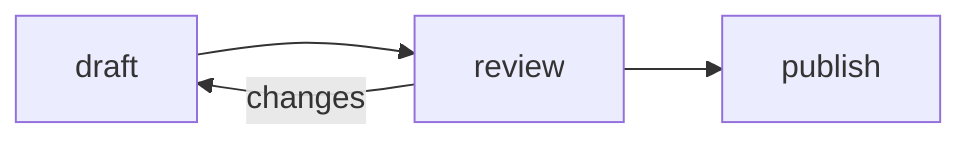

← [Contents](index.md)

## Mermaid diagrams

A `mermaid` fence is drawn as a [Mermaid](https://mermaid.js.org/) diagram:
a flowchart, a sequence, a state machine, a timeline and so on. While you
type, the diagram keeps its last good drawing until the text reads again,
and says under it what's wrong. In a file opened anywhere else, the fence
is still its source. On a dark page, in the [Dark theme](look.md) or on a
dark background, it's drawn in Mermaid's dark theme.

A screen reader hears the diagram as an image, named by an `accTitle:` line
if it has one (`accTitle: How a post is published`), and then its source.

::: tabs
+++ Source
````markdown

````
+++ Rendered

:::

## Music

A `music` fence is a tune in [ABC notation](https://abcnotation.com/), the plain-text way tunes are written down, drawn on a staff by [abcjs](https://abcjs.net/), with **Play** in its lower right.
Its header says its title (`T:`), time (`M:`), note length (`L:`) and key (`K:`), and the notes come after, a bar line `|` between bars.
That's the basics; everything else ABC can say, and how it's drawn and played, is abcjs's, so see [abcjs](https://abcjs.net/) for what it can do, and tell [abcjs](https://github.com/paulrosen/abcjs/issues) about a tune it draws or plays wrong.
In a file opened anywhere else, the fence is still its text.

::: tabs
+++ Source
````markdown
```music
X:1
T:Twinkle, Twinkle
M:4/4
L:1/4
K:C
C C G G | A A G2 | F F E E | D D C2 |]
```
````
+++ Rendered
```music
X:1
T:Twinkle, Twinkle
M:4/4
L:1/4
K:C
C C G G | A A G2 | F F E E | D D C2 |]
```
:::

- **Play** plays it on a piano, each note marked on the staff as it sounds, a little bolder and in the page's accent, and turns to **Pause**, which waits where it is until Play carries on. It plays on a slide and in Work too.
- Once it's begun, **Back to the start** is beside it: playing, it plays on from the start; paused, it waits there. At its end, it's as it was before it was played.
- The piano's notes come from abcjs's website the first time each is played, through reader, which keeps them in a cache folder of its own, outside your files (`~/Library/Caches/reader` on a Mac, `~/.cache/reader` on Linux, or wherever `READER_CACHE` says). So a tune plays offline once its notes have been played; one that hasn't says it needs the network.
- A screen reader hears the staff as an image named by its title, key, time and bars, "Twinkle, Twinkle: C major, 4/4, 4 bars", and then its text.
- ABC with something wrong in it shows its text, what's wrong under it, and what could be drawn of it, faded.
- An exported page shows the staff as it was drawn, with no button.

## Headlines

A `headline` fence is set like a clipping from the paper it ran in: the
paper's name, the headline, and who wrote it and when.

::: tabs
+++ Source
````markdown
```headline
City Library Will Stay Open Until Midnight, "For the Night Owls"

The board says the late hours are a trial through spring.
agency: The New York Times
by: A. Reporter
date: October 3, 2026
url: https://www.nytimes.com/2026/10/03/the-story.html
```
````
+++ Rendered
```headline
City Library Will Stay Open Until Midnight, "For the Night Owls"

The board says the late hours are a trial through spring.
agency: The New York Times
by: A. Reporter
date: October 3, 2026
url: https://www.nytimes.com/2026/10/03/the-story.html
```
:::

- The text is the headline, as you'd write it, quotes, commas and all. A
  second paragraph is the line under it.
- `agency:`, `by:`, `date:` and `url:` lines, anywhere in the fence, say
  the rest; all are optional. The headline links to the `url`.
- The New York Times, The Atlantic, The Guardian, WIRED and Slashdot are
  each set in something like their own type and colors, from fonts your
  machine has (for the Times's nameplate, install
  [Chomsky](https://github.com/ctrlcctrlv/chomsky)). A paper is known by its `agency:` or, without one, by where
  the `url:` points. Any other paper gets a plain clipping.
- Alone on a slide under its title, a headline is centered.

## Numbers

A `number` fence is a figure worth a box of its own: the number, big, and
a line under it saying what it counts.

::: tabs
+++ Source
````markdown
```number
[15%]{seagreen}
daily code change
```
````
+++ Rendered
```number
[15%]{seagreen}
daily code change
```
:::

- The first line is the number; the rest is the line under it, which is
  optional. Both are prose, so `[15%]{seagreen}` colors the number.
- A long number is set smaller, to stay on one line in its box.
- Alone on a slide under its title, a number is centered. For several in a
  row, put them in a `::: columns` block; the boxes come out the same size.

## Images

An image alone in its paragraph is a figure, with a caption: its title if
it has one, otherwise its alt text. Its size goes after its address as
`=WxH`, in pixels, as in the markdown-it-imsize convention. Leave one side
out to keep the image's proportions: `=100x` sets only the width, `=x200`
only the height. A title still goes before it.

::: tabs
+++ Source
```markdown

```
+++ Rendered

:::

First in a `::: row`, beside its text, an image is just the image, with no
caption (see Row in [Layout](layout.md)).
